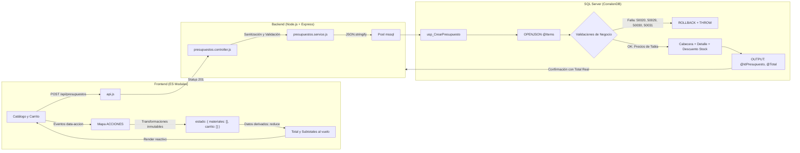

# Presupuestador del Corralón Don Pedro
**Instituto Superior Villa del Rosario — Tecnicatura Superior en Desarrollo de Software**  
**Cátedra:** Programación II — Ciclo 2026 — Clase 15  

---

## 1. Descripción del Sistema y Arquitectura

El **Presupuestador del Corralón Don Pedro** es una solución integral desarrollada bajo una arquitectura cliente-servidor desacoplada y robusta, diseñada para resolver la cotización de materiales de obra con consistencia transaccional y cálculo en tiempo real.



### Principios Fundamentales Implementados

1. **La Base de Datos Tiene la Última Palabra (Zero-Trust Frontend):**  
   El navegador nunca envía precios ni montos finales. El frontend únicamente transmite la lista de materiales requeridos (`{ id, cantidad }`). La base de datos calcula el total definitivo basándose en sus propios registros vigentes en el instante en que se ejecuta la transacción.
2. **Estado Mínimo:**  
   En memoria del navegador reside únicamente `estado = { materiales: [], carrito: [] }`. Nombres, precios unitarios, subtotales y total acumulado son **datos derivados** calculados en el renderizado mediante funciones puras (`reduce`, `find`).
3. **Inmutabilidad:**  
   Toda modificación del carrito se realiza creando copias nuevas con operadores `spread` (`...`), `map` y `filter`, erradicando mutaciones destructivas como `.push()` o modificaciones de propiedades directas.
4. **Despacho O(1) con Delegación de Eventos:**  
   La interfaz utiliza un objeto `ACCIONES` y selectores con atributos `data-accion` y `data-id`. Cero cadenas de condicionales `if/else` en el manejo del DOM.
5. **Atomicidad Transaccional (ACID):**  
   El procedimiento `usp_CrearPresupuesto` asegura que la cabecera, el detalle con precio congelado y la deducción de inventario se confirmen juntos o se descarten por completo vía `ROLLBACK`.

---

## 2. Estructura del Proyecto

```text
Clase15/
├── CorralonDB.sql                     # Script maestro de base de datos (tablas, datos, SPs)
├── README.md                          # Documentación técnica y protocolo de pruebas
├── back/
│   ├── .env                           # Variables de entorno locales (gitignored)
│   ├── .gitignore                     # Exclusión de node_modules, .env y logs
│   ├── env.ejemplo                    # Plantilla de configuración
│   ├── package.json                   # Definición de dependencias y scripts de backend
│   ├── package-lock.json              # Bloqueo de versiones
│   └── src/
│       ├── server.js                  # Servidor Express y servidor estático del front
│       ├── config/
│       │   └── db.js                  # Conexión y Pool con mssql
│       ├── controllers/
│       │   └── presupuestos.controller.js  # Sanitización y respuesta HTTP
│       ├── middlewares/
│       │   ├── asyncHandler.js        # Wrapper asíncrono para errores
│       │   ├── errores.js             # Middleware centralizado de errores (400, 404, 500)
│       │   └── logger.js              # Registro de peticiones HTTP en consola
│       ├── routes/
│       │   └── presupuestos.routes.js # Mapeo de rutas de la API REST
│       └── services/
│           └── presupuestos.service.js# Comunicación con procedimientos almacenados
└── front/
    ├── index.html                     # Maquetado semántico (Catálogo, Carrito, Historial)
    ├── estilos.css                    # Estilos visuales y diseño responsive
    └── js/
        ├── api.js                     # Servicios de consumo Fetch hacia la API
        ├── app.js                     # Orquestador del estado, transformaciones y eventos
        ├── formato.js                 # Utilidades de formato de moneda (ARS) y fechas
        └── componentes/
            ├── filaMaterial.js        # Componente de fila de catálogo
            └── itemCarrito.js         # Componente de item de carrito (+ / − / ✕)
```

---

## 3. Puesta en Marcha

### Requisitos Previos
* SQL Server Express (instancia local `SQLEXPRESS` con autenticación SQL).
* Node.js v18 o superior.

### Paso 1: Base de Datos
Ejecutar el script [`CorralonDB.sql`](./CorralonDB.sql) en SQL Server Management Studio (SSMS) o mediante consola:
```bash
sqlcmd -S "localhost\SQLEXPRESS" -U sa -P esea -i CorralonDB.sql
```

### Paso 2: Variables de Entorno (`back/.env`)
Crear el archivo `back/.env` (no versionado en Git) con el siguiente contenido:
```env
PORT=3000
DB_SERVER=localhost
DB_INSTANCE=SQLEXPRESS
DB_DATABASE=CorralonDB
DB_USER=sa
DB_PASSWORD=esea
DB_ENCRYPT=false
DB_TRUST_CERT=true
```

### Paso 3: Backend y Servidor Web
Situarse en la carpeta `back/`:
```bash
npm install
npm run dev
```
El sistema estará accesible en el navegador en:
`http://localhost:3000`

---

## 4. Matriz de Pruebas Obligatorias

### Prueba 1: Agregado Acumulativo sin Duplicados
* **Acción:** Hacer clic 3 veces sobre el botón "Agregar" de *Cemento Holcim 50 kg*.
* **Resultado Esperado:** En el carrito se observa un único elemento correspondiente al Cemento, con cantidad `3`. Nunca se generan tres filas repetidas.
* **Mecanismo:** La función `agregarAlCarrito` verifica mediante `cantidadEnCarrito(id)`: si `actual === 0` añade el elemento con `[...estado.carrito, { id, cantidad: 1 }]`; caso contrario utiliza `.map()` incrementando exclusivamente la propiedad `cantidad`.

### Prueba 2: Decremento y Auto-eliminación al Llegar a Cero
* **Acción:** Presionar el control `−` sobre un ítem con cantidad `1`.
* **Resultado Esperado:** La cantidad pasa a `0` y el ítem desaparece automáticamente de la lista del carrito.
* **Mecanismo:** La función pura `restarDelCarrito` aplica un decremento con `.map()` encadenado a un `.filter(item => item.cantidad > 0)`.

### Prueba 3: Validación Reactiva de Stock
* **Acción:** Intentar agregar un material superando la existencia disponible (por ejemplo, el material *Cerámico símil madera*, que posee Stock `0`, o acumular más de las unidades existentes).
* **Resultado Esperado:** El sistema bloquea la operación, muestra un mensaje de advertencia informando la falta de stock y el estado del carrito permanece intacto.

### Prueba 4: Guardado de Presupuesto y Sincronización de Stock
* **Acción:** Armar un presupuesto con nombre de cliente (ej. *Obra Norte*), presionar "Guardar".
* **Resultado Esperado:**
  1. El mensaje de éxito muestra el total calculado por SQL Server (`OUTPUT @Total`).
  2. El carrito se vacía de inmediato.
  3. Se recarga el catálogo vía `obtenerMateriales()` y la columna de Stock en pantalla refleja el descuento realizado en la base de datos.
  4. La tabla de historial se actualiza incorporando el nuevo registro al inicio.

---

### Prueba 5: La Prueba del Precio Viejo (Punto Crítico de Seguridad y Arquitectura)

#### Procedimiento de Ejecución
1. En la pantalla, agregar 1 bolsa de *Cemento Holcim 50 kg*. La pantalla muestra el precio de $14.200 y el total estimado es `$ 14.200`.
2. **Sin tocar la pantalla ni recargar la página**, abrir SSMS y simular un cambio de precio urgente efectuado por administración:
   ```sql
   UPDATE dbo.Materiales
   SET Precio = 99999.00
   WHERE IdMaterial = 1;
   ```
3. Volver a la pantalla del presupuestador, ingresar un nombre de cliente (ej. *Constructora San José*) y presionar **Guardar**.
4. **Resultado Verificado:**
   * El mensaje devuelto por el sistema indica:  
     `Presupuesto N° X guardado. Total: $ 99.999.`
   * El total guardado tomó el precio **nuevo** ($99.999) y no el precio viejo ($14.200) que el usuario veía en pantalla.

#### Justificación Teórica de Ingeniería de Software
* **¿Por qué esto es lo correcto?**  
  En un sistema transaccional comercial, la pantalla es simplemente un medio de captura y pre-visualización. La única fuente de verdad con potestad jurídica y contable sobre las tarifas es la base de datos central.
* **¿Qué ocurriría si el frontend enviara los precios?**  
  1. **Vulnerabilidad de Manipulación de Peticiones (Payload Tampering):** Si el frontend enviara `[{ id: 1, precio: 14200 }]`, cualquier usuario con conocimientos básicos de herramientas de desarrollo (DevTools, Postman, cURL) o un proxy interceptor podría modificar el JSON a `[{ id: 1, precio: 1.00 }]`, comprando materiales a un costo irrisorio.
  2. **Inconsistencia de Concurrencia e Inflación:** En rubros con alta variabilidad de costos (como la construcción), los presupuestos emitidos deben reflejar el precio vigente al momento exacto del cierre de la transacción, evitando pérdidas operativas para la empresa por desfases de caché en el cliente.

---

### Prueba 6: Validaciones de Backend y Garantía de ROLLBACK

Se probaron los endpoints directamente mediante peticiones HTTP para certificar la respuesta del controlador y la integridad transaccional de `usp_CrearPresupuesto`:

#### Caso A: Carrito Vacío (Error 50031 -> HTTP 400)
```bash
curl -X POST http://localhost:3000/api/presupuestos \
  -H "Content-Type: application/json" \
  -d '{"cliente": "Carlos Perez", "items": []}'
```
* **Respuesta:** Status `400 Bad Request` con mensaje `"El presupuesto debe tener al menos un item."`

#### Caso B: Cantidad Inválida (Error 50020 -> HTTP 400)
```bash
curl -X POST http://localhost:3000/api/presupuestos \
  -H "Content-Type: application/json" \
  -d '{"cliente": "Carlos Perez", "items": [{"id": 1, "cantidad": 0}]}'
```
* **Respuesta:** Status `400 Bad Request` con mensaje `"Cada item debe tener id numérico y cantidad mayor a cero."`

#### Caso C: Material Inexistente y Verificación de ROLLBACK (Error 50029 -> HTTP 400)
```bash
curl -X POST http://localhost:3000/api/presupuestos \
  -H "Content-Type: application/json" \
  -d '{"cliente": "Carlos Perez", "items": [{"id": 999, "cantidad": 1}]}'
```
* **Respuesta:** Status `400 Bad Request` con mensaje `"Algún material del carrito no existe."` (Código T-SQL `50029`).
* **Verificación de ROLLBACK en Base de Datos:**
  Al consultar las tablas tras la petición rechazada:
  ```sql
  SELECT * FROM dbo.Presupuestos WHERE Cliente = 'Carlos Perez';
  -- Retorna 0 filas (no se creó la cabecera)

  SELECT * FROM dbo.DetallePresupuesto WHERE IdMaterial = 999;
  -- Retorna 0 filas (no se crearon detalles huérfanos)
  ```
  Ningún stock fue descontado y ninguna fila fue persistida, garantizando la atomicidad absoluta del sistema.

---

## 5. Rúbrica de Evaluación de la Cátedra

| Criterio | Peso | Estado de Cumplimiento |
| :--- | :---: | :--- |
| **Estado mínimo + datos derivados** | 25% | **Completado.** Carrito almacena exclusivamente `{ id, cantidad }`. Totales y subtotales calculados con `.reduce()`. |
| **Transformaciones puras y mapa de acciones** | 25% | **Completado.** Inmutabilidad total con `spread`, `map`, `filter`. Delegación mediante diccionario `ACCIONES`. |
| **usp_CrearPresupuesto con OPENJSON** | 25% | **Completado.** Transacción única, validaciones (50020, 50029, 50030, 50031), cálculo con precios de tabla y 2 parámetros `OUTPUT`. |
| **Flujo completo** | 10% | **Completado.** Guardado, feedback con total oficial de BD, vaciado reactivo, actualización de stock e historial en vivo. |
| **Pruebas del README (precio viejo) + Git** | 15% | **Completado.** Explicación exhaustiva de la prueba del precio viejo, casos cURL documentados y estructura en 3 commits limpios. |
